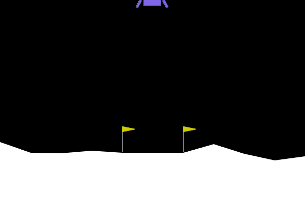

# GravityRocket

Teaching a neural network to land a rocket with reinforcement learning, then breaking it on purpose with one bad reward rule. Built on PPO (Stable-Baselines3) and Gymnasium's LunarLander-v3, on a laptop CPU with no GPU.



The four-panel version of the story is in `videos/rocket_story.mp4`.

## Results

Tested on the plain game with my reward rules off, over 100 attempts per trained rocket, 3 training seeds per rule.

| Reward rule | Training steps | Avg score | Landed | Timed out |
|---|---|---|---|---|
| Built-in reward | 1M | 260 | 100% | 0% |
| Small fee per frame | 1M | 261 | 100% | 0% |
| +1 per steady frame (the bad rule) | 1M | -57 | 0% | 100% |
| Pay for the change + fee (the fix) | 1M | 259 | 99% | under 1% |
| Same fix, trained longer | 2M | 276 | 99% | under 1% |

A score of 200 counts as solved.

## What I found

1. **The bad rule scored about 1,000 in training and -57 in the real game.** It never landed in 300 attempts. It flew up and stayed there, because 1,000 frames of +1 out-earns any landing.
2. **The fix looked done at 1M steps, and wasn't.** Test mode takes the top action. In training mode, which samples actions, 47% of attempts timed out, with the rocket sitting on the pad and twitching its engines so the game never ended the attempt. At 2M steps that fell to 0.7%.
3. **Gravity stress test.** The rocket trained at gravity -10 kept landing 99%+ from -6 to -11.99, then fell to 90% at -4 and 71% at -2. It learned this world, not flying.

## Run it

```bash
uv venv --python 3.12 .venv
uv pip install --python .venv/bin/python -r requirements.txt
.venv/bin/python src/train.py --rule hover_hack --seed 1
.venv/bin/python src/evaluate.py
```

The rules live in `src/rewards.py`.
